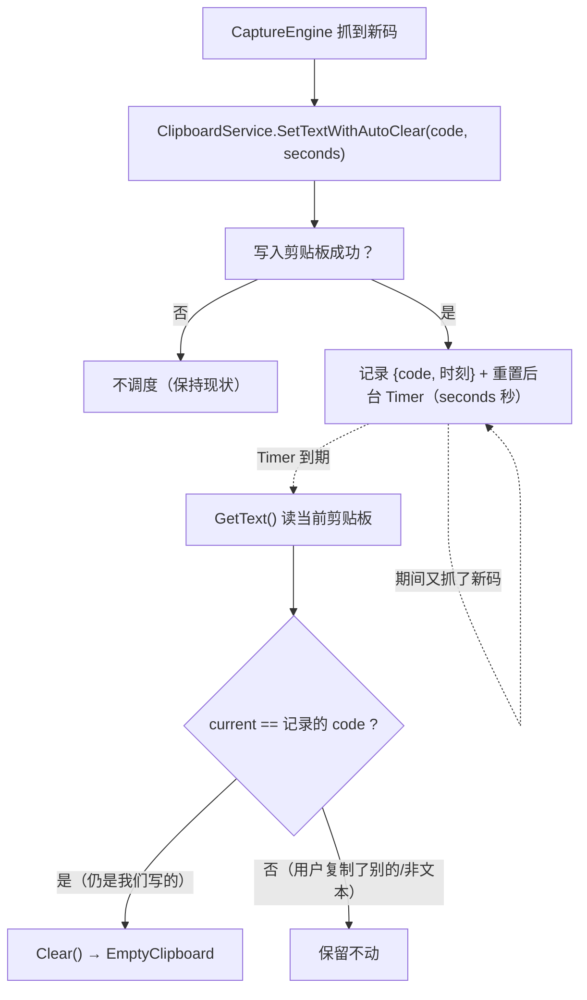

# 剪贴板自动清空 — 设计文档

日期：2026-09-11
状态：设计已获用户批准（用户决定「做成可调」）

## 需求

**用户原话**：「给我加个功能在复制成功3分钟后删除剪切板的内容」

**澄清结果**（用户在二选一中选了第 1 项）：
- 复制房间码成功后，延迟一段时间自动清空剪贴板；
- **只在剪贴板内容仍是程序写入的那个码时清空**——若用户在此期间复制了别的内容，保留不动，不误删；
- 延迟时长**做成可调**（默认 180 秒）。

**目标**：抓取到房间码并写入剪贴板后，经过可配置延迟自动清除它，避免房间码长期留在剪贴板。

**非目标**：
- 不清理用户在延迟期内自行复制的内容（安全约束，用户明确选择）；
- 不改动抓取时序、OCR、预处理或延迟预算（本功能不在热路径上）；
- 不引入新的第三方依赖。

## 方案取舍

| 方案 | 机制 | 结论 |
|---|---|---|
| **A. 独立后台定时器**（选定） | `System.Threading.Timer`，写入成功后重置 | **选用**。与抓帧循环解耦，停止抓取后仍生效；职责清晰 |
| B. 抓帧循环轮询 | 在 `CaptureEngine.Loop` 每帧检查 | 否决。50fps 每帧读剪贴板开销大；**停止抓取后不再检查，延迟到了也不会清** |
| C. WinForms Timer | UI 线程回调 | 否决。`ClipboardService` 是纯静态工具类，为它引入 WinForms 依赖不合适 |

## 设计



**数据流**：
1. `CaptureEngine.ProcessFrame` 抓到新码 → 调用 `ClipboardService.SetTextWithAutoClear(code, _config.ClipboardClearSeconds)`。
2. 写入成功后记录 `(code, 时刻)` 并重置后台定时器；**每次新写入都重置**（剪贴板只有一个，只保最后一次）。
3. 定时器到期：读当前剪贴板文本；与记录的码**逐字相等**才清空，否则不动。
4. 程序退出时释放定时器。

## 接口

### `ClipboardService` 新增

```csharp
/// <summary>读剪贴板文本。剪贴板无文本格式（图片/文件/空）时返回 null。</summary>
public static string? GetText();

/// <summary>清空剪贴板。沿用现有 OpenClipboard 重试模式。</summary>
public static bool Clear();

/// <summary>
/// 写入文本，并在 seconds 秒后自动清空（前提：届时剪贴板内容仍是本次写入的文本）。
/// seconds &lt;= 0 时不调度（等于禁用）。
/// </summary>
public static bool SetTextWithAutoClear(string text, int seconds);

/// <summary>释放后台定时器（程序退出时调用，避免残留回调）。</summary>
public static void Shutdown();
```

### `AppConfig` 新增

```csharp
// 复制成功后多少秒自动清空剪贴板（0 = 禁用）。默认 3 分钟。
public int ClipboardClearSeconds { get; set; } = 180;
```

### 可测的纯逻辑

把判定抽成纯函数，供 `LogicTests` 覆盖（不触碰真实剪贴板）：

```csharp
/// <summary>是否应清空：仅当延迟已到 且 当前内容与写入内容逐字相等。</summary>
internal static bool ShouldClear(string? written, string? current, bool delayElapsed)
    => delayElapsed && written != null && current == written;
```

## 边界处理

| 情形 | 行为 |
|---|---|
| 延迟期内又抓到新码 | 重置计时，只对**最后一次**写入计时 |
| 用户复制了别的内容 | 到期校验不符 → 保留不动 |
| `ClipboardClearSeconds = 0` | 完全不调度 |
| 剪贴板是图片/文件等非文本 | `GetText()` 返回 null → 视为「已变」→ 保留 |
| 剪贴板被其他程序占用 | 复用现有 1ms 间隔重试（约 20ms 上限） |
| 程序退出 | 退出路径调用 `ClipboardService.Shutdown()` 释放定时器，避免残留回调 |
| 写入本身失败 | 不调度（避免清掉别人的内容） |

## 验证方式

- **单元测试**（`LogicTests`）：`ShouldClear` 覆盖三种情形——内容一致且到期→清；内容已变→不清；未到期→不清。
- **手动验证**：抓到一个码 → 等到期 → 剪贴板应为空；另一次在延迟期内手动复制一段文字 → 到期后该文字仍在。
- **构建**：主项目 `dotnet build` 0 警告 0 错误；`LogicTests` 全绿。
- **回归**：既有 17 条 `CodeDetector` 用例不受影响。
